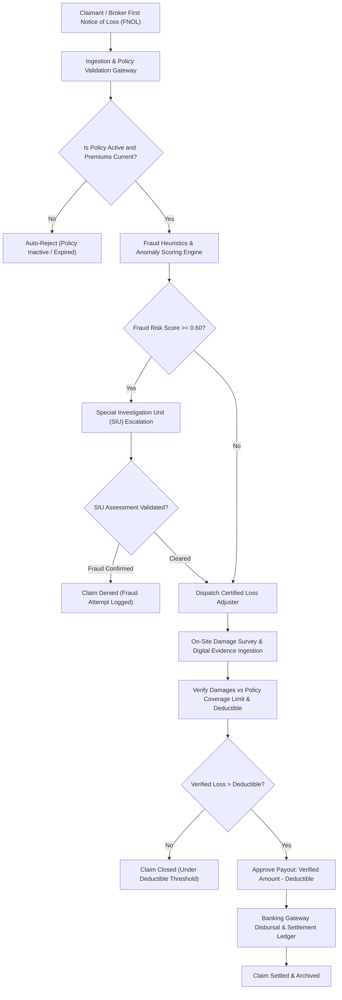
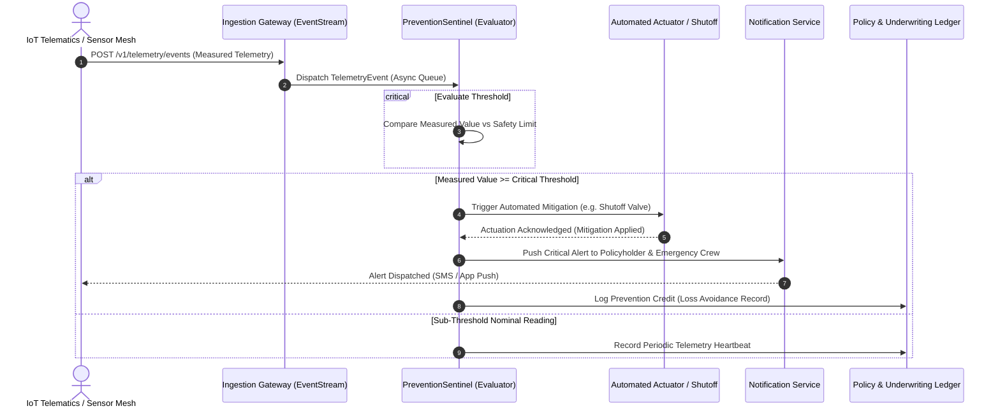

<div align="center">

# Sistema Federación Santillán
### Next-Generation Insurance Underwriting, Heuristic Fraud Triage & Loss Prevention Mesh

[](https://www.python.org/)
[](https://docs.pydantic.dev/)
[]()
[](LICENSE)
[](https://www.conventionalcommits.org/)
[]()

</div>

---

## Executive Summary & Capabilities

**Sistema Federación Santillán** is an enterprise-grade insurance underwriting, automated claims settlement, and proactive loss prevention engine designed for modern mutual and commercial insurance syndicates.

Traditional insurance workflows suffer from protracted manual loss adjustments, delayed First Notice of Loss (FNOL) processing, and vulnerability to organized claim fraud. This platform combines deterministic actuarial validation, multi-vector fraud anomaly scoring, and real-time IoT telemetry sentinels that execute physical mitigation actions before an accident or asset loss escalates into a catastrophic claim.

### Technical Highlights
- **Deterministic Domain Modeling:** Strongly-typed Pydantic v2 schemas for Policies, Claims, and Certified Adjuster Surveys with strict runtime invariant checks.
- **Multi-Vector Fraud Heuristics Engine:** Automated risk scoring covering Rapid Inception Claims (< 15 days), Limit Over-Exposure (> 90%), Off-Hours / Night Incidents, and Recurrent Claimant Histories.
- **Proactive IoT Loss Prevention Sentinel:** High-frequency telemetry evaluation across water flow, fire/smoke, thermal overload, telematics speed, and industrial vibration with automated shutoff commands.
- **Cryptographic Evidence Sealing:** Loss surveyor photo/video verification sealed with SHA-256 evidence digests to prevent post-inspection tampering.
- **Zero-Warning Automated Test Suite:** Complete unit and integration test harness verified across modern Python runtime versions.

---

## Visual Architecture

### 1. Claims Settlement & Heuristic Fraud Triage Pipeline


### 2. Concurrent Telemetry Streaming & Actuation Shutoff


---

## Protocol & API Specifications

### 1. Ingest First Notice of Loss (FNOL)
- **Endpoint:** `POST /api/v1/claims`
- **Headers:** `Content-Type: application/json`, `X-Idempotency-Key: <uuid>`

#### Request Payload
```json
{
  "claim_id": "CLM-2026-9041",
  "policy_id": "POL-2026-001",
  "incident_timestamp": "2026-11-05T14:30:00Z",
  "location": "Av. Corrientes 1234, CABA, Argentina",
  "description": "Rear collision at signalized intersection while vehicle was stationary.",
  "claimed_amount_usd": 4500.0,
  "severity": "MEDIUM"
}
```

#### Response: `201 Created`
```json
{
  "claim_id": "CLM-2026-9041",
  "status": "PENDING_TRIAGE",
  "fraud_evaluation": {
    "risk_score": 0.0,
    "risk_level": "LOW",
    "triggered_rules": [],
    "requires_siu_investigation": false,
    "explanation": "Evaluated with 0 rule triggers. Score: 0.000. Severity: LOW."
  },
  "adjuster_dispatched": true
}
```

#### Error Response: `422 Unprocessable Entity`
```json
{
  "error": "VALIDATION_FAILED",
  "detail": [
    {
      "loc": ["body", "claimed_amount_usd"],
      "msg": "Input should be greater than 0",
      "type": "greater_than"
    }
  ]
}
```

---

### 2. Ingest IoT Prevention Telemetry Event
- **Endpoint:** `POST /api/v1/telemetry/events`
- **Headers:** `Content-Type: application/json`

#### Request Payload
```json
{
  "event_id": "EVT-WAT-88129",
  "device_id": "DEV-WATER-99",
  "policy_id": "POL-HOME-400",
  "sensor_type": "WATER_FLOW",
  "measured_value": 58.2,
  "unit": "L/min",
  "timestamp": "2026-11-05T16:20:00Z"
}
```

#### Response: `200 OK` (Critical Mitigation Actuated)
```json
{
  "alert_id": "ALT-T-88129",
  "policy_id": "POL-HOME-400",
  "sensor_type": "WATER_FLOW",
  "severity": "CRITICAL",
  "mitigation_action": "AUTOMATED_SHUTOFF_COMMAND",
  "incident_prevented_estimate_usd": 15000.0,
  "details": "Threshold exceeded for WATER_FLOW: measured 58.2 L/min >= 45.0 limit."
}
```

---

## Reproducible Build & Test Guide

### Prerequisites
- Python 3.11+ (tested on Python 3.11 and Python 3.14)
- Git 2.40+

### Step-by-Step Shell Instructions

```bash
# 1. Clone repository with submodules (if any)
git clone --recursive https://github.com/nedder3/sistema-federacion-santillan.git
cd sistema-federacion-santillan

# 2. Initialize and activate virtual environment
python -m venv .venv
# On Windows (PowerShell):
.venv\Scripts\Activate.ps1
# On Linux / macOS:
# source .venv/bin/activate

# 3. Install core dependencies and test runner
pip install --upgrade pip
pip install pydantic pytest

# 4. Execute automated test suite with full verbosity
python -m pytest -v
```

---

## Module Layout

```text
sistema-federacion-santillan/
├── diagramas/
│   ├── claims_pipeline_flowchart.mmd     # Mermaid loss adjustment workflow
│   └── telemetry_prevention_sequence.mmd # Mermaid concurrent telemetry & actuation
├── docs/
│   └── CODE-DOCUMENTATION.md             # Architecture & docstring conventions
├── src/
│   ├── domain/
│   │   ├── __init__.py                   # Exported domain models
│   │   └── models.py                     # Policy, Claim, SurveyFinding Pydantic models
│   ├── engine/
│   │   ├── __init__.py                   # Exported calculation engines
│   │   ├── fraud_detector.py             # Multi-vector heuristic fraud scoring
│   │   └── prevention_sentinel.py        # IoT telemetry triage & actuator dispatch
│   └── __init__.py                       # Package entry point
├── tests/
│   ├── test_domain_models.py             # Validation & entity unit tests
│   ├── test_fraud_engine.py              # Heuristic fraud rules & SIU threshold tests
│   └── test_prevention_sentinel.py       # Sensor threshold & mitigation tests
├── .gitignore                            # Production gitignore
├── CHANGELOG.md                          # Project version changelog
├── CONTRIBUTING.md                       # Conventional Commits guideline
└── README.md                             # Production architectural documentation
```

---

## License

This project is licensed under the terms of the [MIT License](LICENSE).
