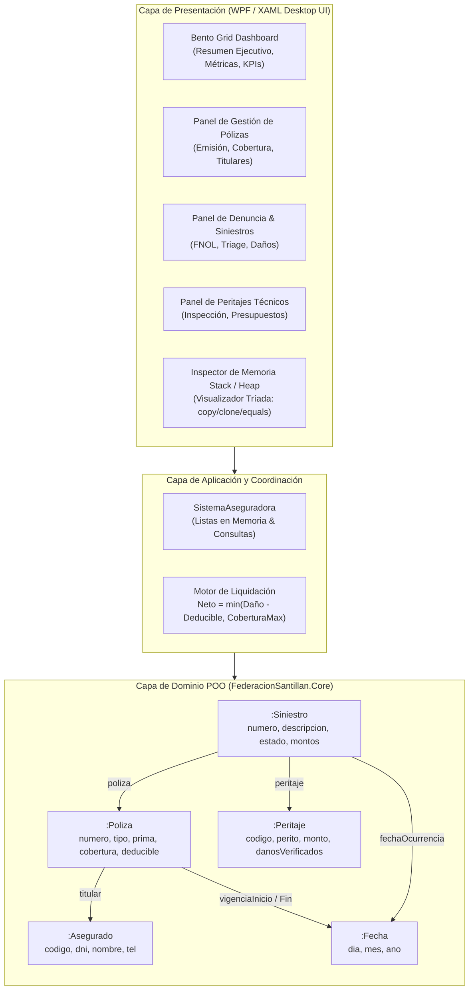

<div align="center">

# Sistema Federación Santillán
### Plataforma de Gestión de Pólizas, Siniestros &amp; Auditoría de Memoria POO en C# .NET 8

[](https://dotnet.microsoft.com/)
[](https://learn.microsoft.com/dotnet/desktop/wpf/)
[]()
[](LICENSE)
[](https://www.conventionalcommits.org/)
[]()

</div>

---

## Resumen Ejecutivo & Capacidades

**Sistema Federación Santillán** es una aplicación de escritorio desarrollada en **C# .NET 8 con WPF (XAML)** para la materia de **Programación Orientada a Objetos (POO)**. Implementa la gestión integral de una aseguradora mutual (emisión de pólizas, administración de asegurados, recepción de siniestros FNOL y liquidación pericial de indemnizaciones), diseñada con estricto apego a las convenciones académicas de memoria y encapsulamiento.

### Aspectos Técnicos Destacados
- **Gestión Rigurosa de Memoria (Stack vs. Heap):** Demostración empírica de aliasing de punteros de referencia frente a instancias independientes en el montículo.
- **La Tríada Sagrada en Profundidad:** Implementación canónica y minimalista de `copy(T obj)` (mutación in-place), `clone()` (creación de nueva instancia idéntica) y `equals(T obj)` (comparación por valor de estado).
- **Encapsulamiento Dual:** Atributos privados con métodos explícitos tradicionales (`getCodigo()`, `setCodigo()`) y propiedades de respaldo compactas en un solo renglón (`public int Codigo { get => codigo; set => codigo = value; }`) para enlace de datos reactivo en XAML.
- **Interfaz Bento Grid de Alto Nivel:** Maquetada en WPF aplicando heurísticas de UX/UI (`ux-ui-heuristic-redesign`), cero emojis de sistema, contraste WCAG AA, tipografía técnica monoespaciada para métricas y paleta Slate Dark.
- **Inspector de Memoria en Caliente:** Módulo interactivo en la UI que ejecuta simulacros de examen en vivo, imprimiendo el estado de las variables, los punteros y el valor de verdad de las operaciones lógicas.

---

## Diagramas de Arquitectura & Memoria

### 1. Diagrama de Objetos en Memoria (Stack vs. Heap)
Representación bipartita que ilustra la asignación de variables de referencia en la Pila y la estructura de instancias y punteros de asociación en el Montículo:

```mermaid
flowchart LR
    subgraph STACK["Variables Locales (Stack / Punteros)"]
        var_a1["a1 (Asegurado)"]
        var_a2["a2 (Asegurado alias)"]
        var_a3["a3 (Asegurado clone)"]
        var_p1["p1 (Poliza)"]
        var_s1["s1 (Siniestro)"]
    end

    subgraph HEAP["Instancias en Memoria (Heap)"]
        obj_a1[":Asegurado<br/>codigo: 1001<br/>nombre: 'Federico Santillan'<br/>dni: '30-11223344-9'"]
        obj_a3[":Asegurado<br/>codigo: 1001<br/>nombre: 'Federico Santillan'<br/>dni: '30-11223344-9'"]

        obj_f1[":Fecha (Inicio)<br/>dia: 1<br/>mes: 1<br/>ano: 2026"]
        obj_f2[":Fecha (Fin)<br/>dia: 31<br/>mes: 12<br/>ano: 2026"]
        obj_fSin[":Fecha (Ocurrencia)<br/>dia: 15<br/>mes: 3<br/>ano: 2026"]

        obj_p1[":Poliza<br/>numero: 5001<br/>tipo: 'AUTO'<br/>coberturaMax: 1000000<br/>deducible: 50000<br/>activa: true"]

        obj_peri[":Peritaje<br/>codigo: 401<br/>perito: 'Ing. Gomez'<br/>montoPresupuestado: 75000<br/>danosVerificados: true"]

        obj_s1[":Siniestro<br/>numero: 901<br/>descripcion: 'Colisión vehicular'<br/>estado: 'LIQUIDADO'<br/>montoReclamado: 80000<br/>montoLiquidado: 55000"]
    end

    var_a1 -->|apunta a| obj_a1
    var_a2 -->|apunta a (mismo objeto)| obj_a1
    var_a3 -->|apunta a (clon nuevo)| obj_a3
    var_p1 -->|apunta a| obj_p1
    var_s1 -->|apunta a| obj_s1

    obj_p1 -->|titular| obj_a1
    obj_p1 -->|vigenciaInicio| obj_f1
    obj_p1 -->|vigenciaFin| obj_f2

    obj_s1 -->|poliza| obj_p1
    obj_s1 -->|fechaOcurrencia| obj_fSin
    obj_s1 -->|peritaje| obj_peri

    classDef stackStyle fill:#e1f5fe,stroke:#0288d1,stroke-width:2px;
    classDef heapStyle fill:#fff9c4,stroke:#fbc02d,stroke-width:2px;
    classDef assocStyle fill:#e8f5e9,stroke:#43a047,stroke-width:2px;

    class var_a1,var_a2,var_a3,var_p1,var_s1 stackStyle;
    class obj_a1,obj_a3,obj_p1,obj_s1,obj_peri heapStyle;
    class obj_f1,obj_f2,obj_fSin assocStyle;
```

### 2. Diagrama del Sistema de Software (Capas & Responsabilidades)
El proyecto incluye el diagrama nativo editable de **Draw.io** en el repositorio:
* **Archivo Draw.io:** [diagramas/diagrama_sistema.drawio](diagramas/diagrama_sistema.drawio) (compatible con `app.diagrams.net` y la extensión Draw.io de VS Code).



---

## Especificación de la Tríada Sagrada & Valores de Verdad

En el modelo de evaluación de la cátedra, cada clase de dominio implementa estrictamente:

```csharp
// 1. COPY: Modifica el estado interno de THIS usando los datos del argumento. Retorna void.
public void copy(Poliza p);

// 2. CLONE: Crea una NUEVA instancia independiente en el Heap con el estado actual. Retorna la clase.
public Poliza clone();

// 3. EQUALS: Compara igualdad de estado/contenido, NO la dirección de memoria. Retorna bool.
public bool equals(Poliza p);
```

### Tabla de Resolución de Valores de Verdad (Preguntas de Examen)

Dada la secuencia de ejecución:
```csharp
a1 = new Asegurado(1001, "Federico");
a2 = a1;            // Aliasing
a3 = a1.clone();    // Clonación
p1 = new Poliza(..., a1);
p2 = p1.clone();    // Clonación en profundidad
```

| Operación | Valor de Verdad | Fundamento Técnico de Memoria |
|---|:---:|---|
| `a1 == a2` | **TRUE** | Ambas variables en el Stack contienen el mismo puntero hacia el mismo objeto en Heap. |
| `a1 == a3` | **FALSE** | `a3` nació de un `clone()`. Son dos bloques de memoria físicamente independientes. |
| `a1.equals(a3)` | **TRUE** | Tienen idéntico estado en sus atributos privados. |
| `p1 == p2` | **FALSE** | Instancias distintas en el Heap generadas por el constructor en `clone()`. |
| `p1.equals(p2)` | **TRUE** | Mismo número de póliza, cobertura y asegurado titular. |
| `p1.VigenciaInicio == p2.VigenciaInicio` | **FALSE** | La clonación profunda duplicó el objeto `Fecha` asociado. |
| `p1.VigenciaInicio.equals(p2.VigenciaInicio)` | **TRUE** | Coinciden día, mes y año de la vigencia. |

---

## Guía de Compilación & Ejecución Reproducible

### Requisitos Previos
* **.NET 8.0 SDK** (instalado en `%LOCALAPPDATA%\Microsoft\dotnet` o agregado al PATH).
* Sistema Operativo: Windows 10/11 (para ejecución de la interfaz gráfica WPF).

### Comandos de Shell (PowerShell)

```powershell
# 1. Posicionarse en la raíz del proyecto
cd C:\Users\arijd\Documents\Atlas\projects\sistema-federacion-santillan

# 2. Restaurar dependencias de la solución
dotnet restore

# 3. Compilar la solución completa (Core, Tests y App)
dotnet build

# 4. Ejecutar la suite automatizada de pruebas unitarias xUnit
dotnet test

# 5. Iniciar la aplicación de escritorio WPF
dotnet run --project src/FederacionSantillan.App
```

---

## Estructura de la Solución

```text
sistema-federacion-santillan/
├── FederacionSantillan.sln               # Solución unificada de Visual Studio / .NET CLI
├── diagramas/
│   ├── diagrama_objetos_memoria.mmd      # Diagrama Mermaid de Objetos Stack vs Heap
│   ├── diagrama_sistema.drawio           # Diagrama nativo Draw.io (Capas y Arquitectura)
│   └── diagrama_sistema_arquitectura.mmd # Versión Mermaid del sistema para markdown
├── src/
│   ├── FederacionSantillan.Core/         # Biblioteca de Clases (Dominio POO Puro)
│   │   ├── Asegurado.cs                  # Entidad titular con Tríada y getters/setters
│   │   ├── Fecha.cs                      # Clase fecha básica con validación
│   │   ├── Peritaje.cs                   # Informe técnico de perito liquidador
│   │   ├── Poliza.cs                     # Póliza asociada con liquidación matemática
│   │   ├── Siniestro.cs                  # Denuncia FNOL y ciclo de liquidación
│   │   └── SistemaAseguradora.cs         # Administrador en memoria de la aseguradora
│   └── FederacionSantillan.App/          # Aplicación de Escritorio WPF XAML
│       ├── App.xaml                      # Configuración de arranque de la aplicación
│       ├── MainWindow.xaml               # Interfaz Bento Grid en XAML Dark Slate
│       └── MainWindow.xaml.cs            # Controlador y runner del inspector de memoria
├── tests/
│   └── FederacionSantillan.Tests/        # Proyecto de Pruebas xUnit
│       └── TriadaSagradaTests.cs         # Tests de aliasing, clonación y liquidación
├── .gitignore                            # Exclusión de bin/, obj/, .vs/, AGENTS.md, ROADMAP.md
├── CHANGELOG.md                          # Historial de cambios
├── CONTRIBUTING.md                       # Protocolo de Conventional Commits
└── README.md                             # Documentación arquitectónica de entrega
```

---

## Licencia

Este proyecto se distribuye bajo la licencia [MIT](LICENSE).
