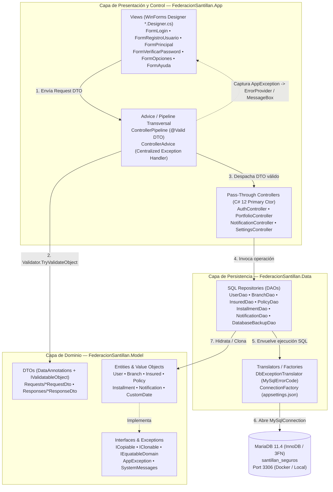
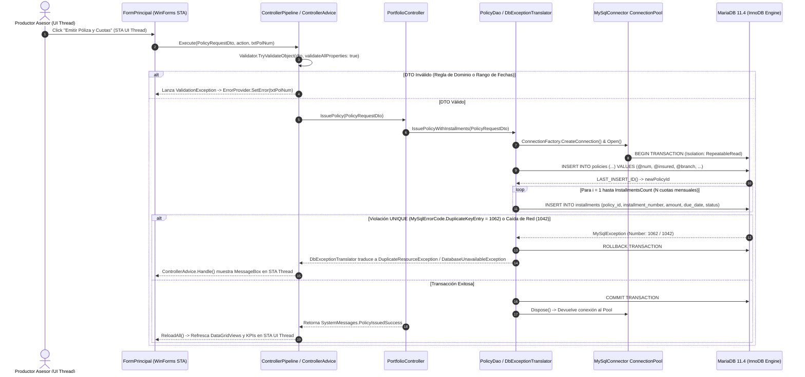
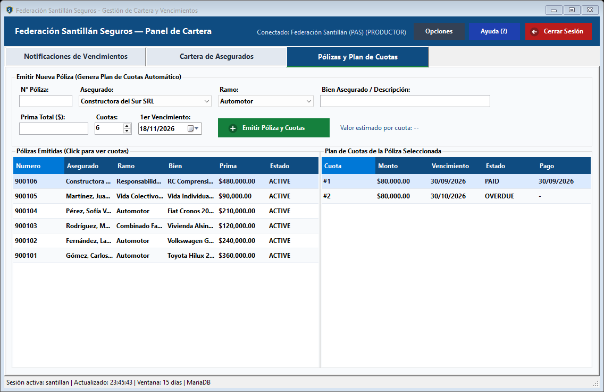
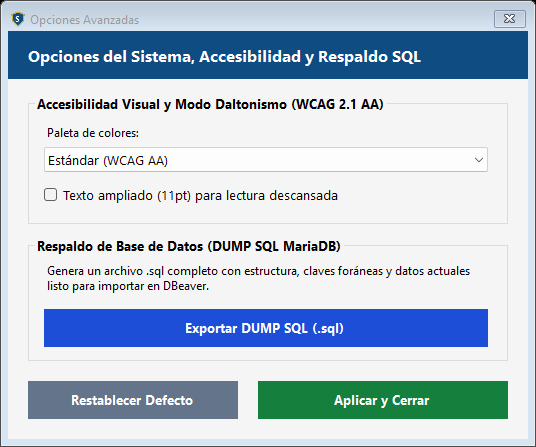

<div align="center">

# Federación Santillán Seguros
### Sistema de Gestión de Cartera, Cobranzas y Alertas de Vencimientos


-003545?style=for-the-badge&logo=mariadb)


-15803D?style=for-the-badge)


**Proyecto Final 2026 — I.S.F.T. N° 191 (Bahía Blanca) — TS en Desarrollo de Software**  
*Desarrollado para Productor Asesor de Seguros (PAS) operando con **Federación Patronal Seguros S.A.***

</div>

---

## 1. Resumen Ejecutivo y Capacidades

**Federación Santillán Seguros** es un sistema de escritorio desarrollado en **C# 12 (.NET 8 Windows Forms)** compatible con **Visual Studio Form Designer (`*.Designer.cs`)** y respaldado por **MariaDB 11.4** en **Tercera Forma Normal (3FN)**. Resuelve la problemática operativa real de una oficina de seguros que gestionaba su cartera en planillas de cálculo dispersas, eliminando la duplicación de datos de contacto y automatizando la detección temprana de morosidad y vencimientos.

### Capacidades Técnicas Destacadas
* **Arquitectura MVC en 3 Capas Estrictas + SOLID:**
  * `FederacionSantillan.Model`: Entidades de dominio con encapsulamiento estricto (`getX()` / `setX()` con cuerpos de expresión `=>`, `copy()`, `clone()` en profundidad, `equals()`), contratos en `Interfaces/`, DTOs segregados en `Requests/` (`DataAnnotations` + `IValidatableObject`) y `Responses/`, y jerarquía de excepciones de dominio (`AppException`, `SystemMessages`).
  * `FederacionSantillan.Data`: Repositorios SQL (`DAOs/`) desacoplados con `MySqlConnector`, `Factories/ConnectionFactory`, `Translators/DbExceptionTranslator` (basado en `MySqlErrorCode` tipado, cero *magic numbers*) y generador autónomo de respaldos `DatabaseBackupDao`.
  * `FederacionSantillan.App`: Controladores *pass-through* con constructores primarios C# 12 (`Controllers/`), pipeline transversal de validación y manejo centralizado de errores estilo Spring Boot `@ControllerAdvice` (`Advice/ControllerPipeline` y `ControllerAdvice`), y vistas `WinForms` (`Views/`).
* **Emisión Transaccional ACID de Pólizas y Cuotas:** Al emitir una póliza, `PolicyDao` inserta la póliza y calcula/genera automáticamente sus $N$ cuotas mensuales consecutivas dentro de una única transacción SQL (`COMMIT` / `ROLLBACK`).
* **Motor de Alertas $O(N)$ / $O(1)$ e Integración con WhatsApp y CSV:** Sincronización automática de cuotas vencidas (`OVERDUE`) y próximas a vencer (`PENDING` a 7, 15 o 30 días), indexación en memoria `Dictionary<int, Installment>` en $O(1)$ y consulta SQL acelerada mediante índice compuesto B-Tree `idx_installment_due_status (due_date, status)` en $O(\log N)$.
* **Seguridad SHA-256 y Respaldo SQL DUMP Protegido:** Autenticación con hash criptográfico irreversible SHA-256 y doble verificación modal de contraseña (`FormVerificarPassword`) antes de exportar copias de seguridad completas (`.sql`).
* **Accesibilidad Visual Científica (WCAG 2.1 AA / Okabe-Ito):** Soporte dinámico de paleta para daltonismo (*Okabe-Ito*), modo Alto Contraste y escalado tipográfico en `FormOpciones`.

### Fundamentación Normativa y Estándares Públicos del DER (3FN)
1. **Marco Legal Argentino — [Ley Nacional N° 22.400](http://servicios.infoleg.gob.ar/infolegInternet/anexos/20000-24999/20968/texact.htm):** Régimen de Productores Asesores de Seguros (Superintendencia de Seguros de la Nación - SSN).
2. **Database Answers Canonical Insurance Model:** Estructura canónica `Party/Insured` $\rightarrow$ `Policy` $\rightarrow$ `Installments` $\rightarrow$ `Notifications`.
3. **ACORD Insurance Data Standards:** Separación en 3FN entre la entidad contractual (`policies`), el catálogo oficial de ramos (`branches`) y el cronograma financiero de facturación (`installments`).

---

## 2. Arquitectura Visual (Mermaid)

### A. Flujo de Datos y Arquitectura MVC en 3 Capas (`flowchart`)



### B. Modelo de Concurrencia, Transaccionalidad ACID y Fronteras de Hilo UI (`sequenceDiagram`)



---

## 3. Especificación de Contratos, Esquema JSON y Payloads SQL

### A. Esquema de Configuración (`src/FederacionSantillan.App/appsettings.json`)
```json
{
  "ConnectionStrings": {
    "SantillanDb": "Server=localhost;Port=3306;Database=santillan_seguros;Uid=santillan;Pwd=santillan123;CharSet=utf8mb4;AllowUserVariables=True;"
  },
  "AppSettings": {
    "CompanyName": "Federación Santillán Seguros",
    "UpcomingDaysThreshold": 15
  }
}
```

### B. Contratos DTO de Entrada / Salida y Códigos de Estado de Persistencia

#### Ejemplo de Payload de Entrada (`PolicyRequestDto`)
```json
{
  "PolicyNumber": 900107,
  "InsuredId": 1,
  "BranchId": 1,
  "Company": "Federación Patronal Seguros",
  "InsuredAsset": "Toyota Corolla Cross SEG 2025 - Patente AH102ZZ",
  "TotalPremium": 420000.00,
  "InstallmentsCount": 6,
  "StartDate": "2026-11-18",
  "EndDate": "2027-11-18",
  "FirstDueDate": "2026-12-10"
}
```

#### Ejemplo de Payload de Respuesta del Tablero (`AlertsDashboardResponseDto`)
```json
{
  "OverdueTotal": 160000.00,
  "UpcomingTotal": 90000.00,
  "Overdue": [
    {
      "InstallmentId": 12,
      "PolicyNumberRef": 900106,
      "InsuredNameRef": "Constructora del Sur SRL",
      "InsuredPhoneRef": "291-4550011",
      "BranchNameRef": "Responsabilidad Civil",
      "InstallmentNumber": 2,
      "Amount": 80000.00,
      "DueDate": "29/10/2026",
      "Status": "OVERDUE"
    }
  ]
}
```

#### Mapeo Determinístico de Códigos de Estado y Excepciones (`DbExceptionTranslator`)
| Código Motor / Validación | Enum / Origen | Excepción de Dominio Lanzada | Comportamiento en UI (`ControllerAdvice`) |
| :---: | :--- | :--- | :--- |
| **`200 / OK`** | Operación SQL / Validación exitosa | *(Ninguna)* | Actualiza grillas, KPIs y confirma acción. |
| **`400 / Validation`** | `Validator.TryValidateObject` / `IValidatableObject` | `ValidationException` | Marca el campo con `ErrorProvider` + `MessageBoxIcon.Warning`. |
| **`401 / Unauthorized`** | Usuario inexistente o contraseña incorrecta | `InvalidCredentialsException` | Alerta genérica *"Credenciales inválidas."* sin revelar la existencia del usuario (`MessageBoxIcon.Warning`). |
| **`404 / Not Found`** | Registro de negocio inexistente | `ResourceNotFoundException` | Informa recurso no encontrado (`MessageBoxIcon.Warning`). |
| **`409 / Conflict (1062)`** | `MySqlErrorCode.DuplicateKeyEntry` (`1062`) | `DuplicateResourceException` | Informa DNI/CUIT, usuario o N° de póliza duplicado. |
| **`503 / Unavailable (1042)`** | `MySqlErrorCode.UnableToConnectToHost` (`1042` / `0`) | `DatabaseUnavailableException` | Alerta caída o falta de conexión con el servidor MariaDB (`MessageBoxIcon.Error`). |

---

## 4. Galería Visual de la Aplicación (Capturas Reales en Vivo)

| Inicio de Sesión (`FormLogin`) | Alta de Usuario (`FormRegistroUsuario`) |
| :---: | :---: |
|  |  |

| Tablero Principal de Alertas y Morosos (`FormPrincipal`) | ABM de Cartera de Asegurados (`FormPrincipal`) |
| :---: | :---: |
|  |  |

| Emisión de Pólizas y Plan de Cuotas (`FormPrincipal`) | Opciones WCAG AA / Okabe-Ito y Exportación SQL DUMP |
| :---: | :---: |
|  |  |

---

## 5. Guía de Construcción Reproducible, Docker y Ejecución de Tests

### Paso 1: Clonar el Repositorio
```bash
git clone --recursive git@github.com:nedder3/santillan-seguros.git
cd santillan-seguros
```

### Paso 2: Levantar la Base de Datos MariaDB 11.4
#### Opción A — Con Docker Compose (Mac / Linux / Windows)
```bash
docker compose up -d
```
Levanta automáticamente el contenedor `santillan_seguros_db` (`mariadb:11.4`) en `localhost:3306` e inicializa `database/01_schema.sql` y `database/02_seed.sql`.

#### Opción B — Importación Directa en DBeaver (Sin Docker)
1. Abrir **DBeaver** y conectar a una instancia local de MariaDB/MySQL en `localhost:3306`.
2. Abrir y ejecutar el script consolidado único: `database/santillan_seguros_completo.sql`.

### Paso 3: Compilar la Solución y Ejecutar la Suite de Pruebas Automatizadas
```bash
dotnet restore FederacionSantillan.sln
dotnet build FederacionSantillan.sln --configuration Release
dotnet test FederacionSantillan.sln --logger "console;verbosity=normal"
```
> **Resultado verificado:** `18/18 tests passing` (clonación profunda `clone()` / `copy()` / `equals()`, facturación y cálculo de mora en `Installment`, validaciones declarativas en DTOs, autenticación segura sin fuga de información e integración en vivo contra MariaDB).

### Paso 4: Ejecutar la Aplicación Desktop (Visual Studio o CLI)
* **Desde Visual Studio 2022+:** Abrir `FederacionSantillan.sln`, definir `FederacionSantillan.App` como *Startup Project* y presionar `F5`.
* **Desde línea de comandos:**
  ```bash
  dotnet run --project src/FederacionSantillan.App/FederacionSantillan.App.csproj
  ```
* **Credenciales de Acceso Precargadas:**
  * **Rol Productor:** Usuario `santillan` | Contraseña `seguros2026`
  * **Rol Administrador:** Usuario `admin` | Contraseña `admin123`

---

## 6. Entregables Oficiales en PDF y Diagramas Nativos de Visual Studio

Todos los documentos requeridos por la cátedra (**Proyecto Final 2026** y **Rúbrica de Cotejo**) se encuentran generados y listos para entregar en `docs/pdf/`:

| Archivo PDF Entregable | Contenido Académico |
| :--- | :--- |
| **[docs/pdf/01_Estudio_Factibilidad_y_Entrevista.pdf](docs/pdf/01_Estudio_Factibilidad_y_Entrevista.pdf)** | Respuestas completas a las **6 preguntas oficiales de relevamiento**, requerimientos funcionales (`RF-01`..`RF-05`) y estudio de factibilidad técnica, operativa y económica. |
| **[docs/pdf/02_DER_Diccionario_Datos_y_DEPs.pdf](docs/pdf/02_DER_Diccionario_Datos_y_DEPs.pdf)** | **Modelo Entidad-Relación (DER en 3FN)** fundamentado en Ley N° 22.400 (SSN) y ACORD, **Diccionario de Datos** de las 6 tablas y **Especificación Estructurada de Procesos (DEP)**. |
| **[docs/pdf/03_Diagramas_UML_y_DFD.pdf](docs/pdf/03_Diagramas_UML_y_DFD.pdf)** | **Diagrama de Clases UML** en 3 capas, **Diagrama de Casos de Uso**, **Diagrama de Secuencia UML**, **Diagrama de Contexto (DFD Nivel 0)** y **DFD Nivel 1**. |
| **[docs/pdf/04_Manual_de_Usuario.pdf](docs/pdf/04_Manual_de_Usuario.pdf)** | **Manual de Usuario** paso a paso ilustrado con las **8 capturas reales** de la aplicación WinForms conectada a MariaDB (`docs/screenshots/`). |

### Diagramas de Clases Nativos para Visual Studio Class Designer (`.cd`)
* `src/FederacionSantillan.Model/ModelClassDiagram.cd`
* `src/FederacionSantillan.Data/DataLayerDiagram.cd`
* `src/FederacionSantillan.App/MvcArchitectureDiagram.cd`
