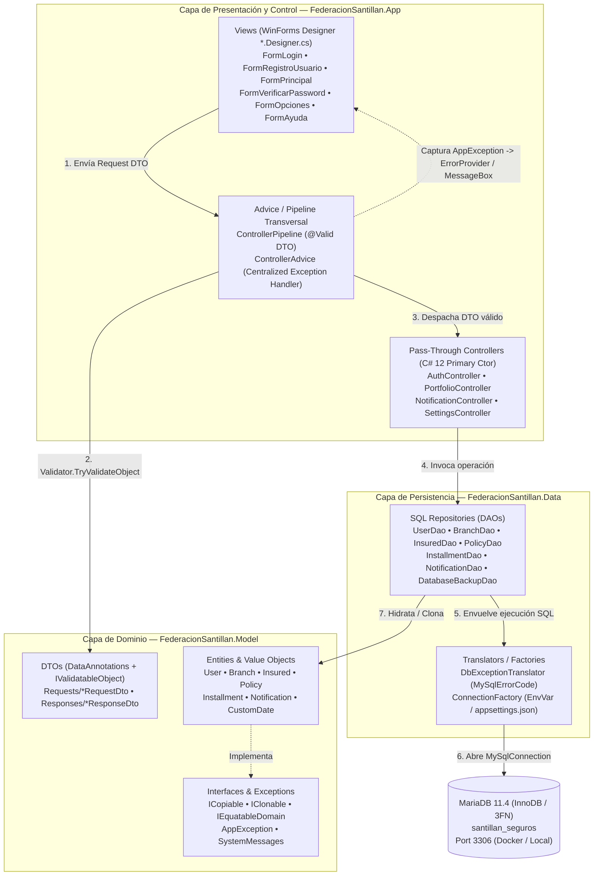
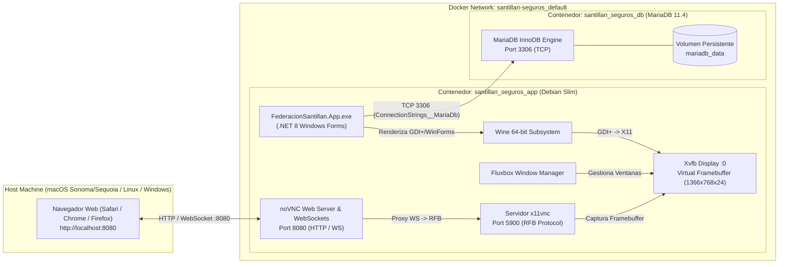
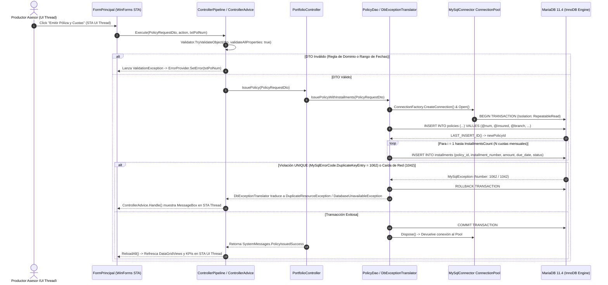
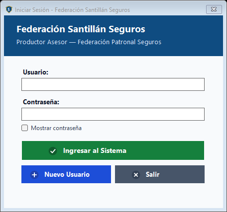
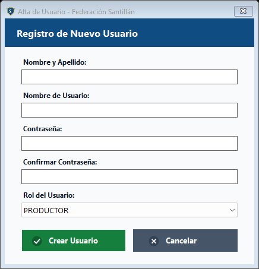
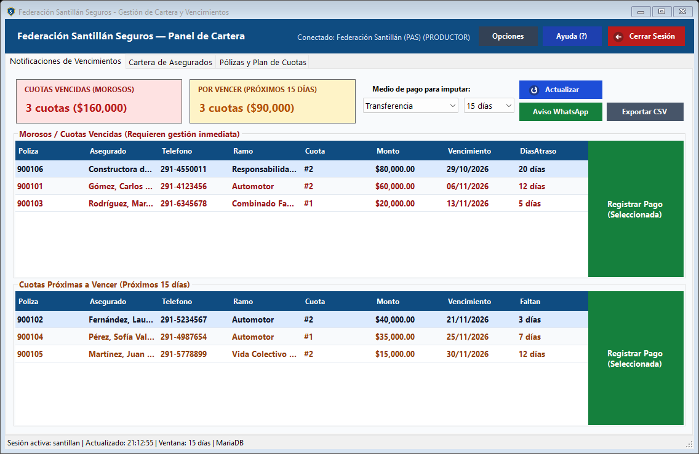
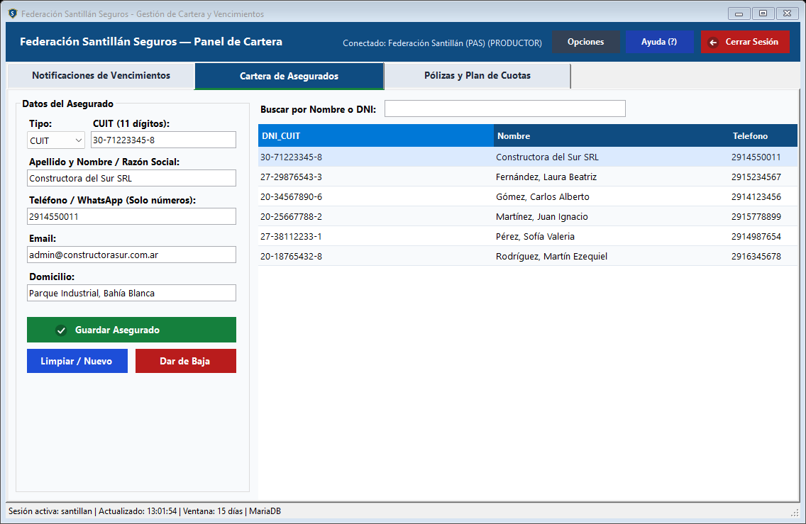

<div align="center">

# Federación Santillán Seguros
### Sistema de Gestión de Cartera, Cobranzas y Alertas de Vencimientos


-003545?style=for-the-badge&logo=mariadb)

-2496ED?style=for-the-badge&logo=docker)
-15803D?style=for-the-badge)
%20Lookup%20%7C%20O(log%20N)%20B--Tree-F59E0B?style=for-the-badge)


**Proyecto Final 2026 — I.S.F.T. N° 191 (Bahía Blanca) — TS en Desarrollo de Software**  
*Desarrollado para Productor Asesor de Seguros (PAS) operando con **Federación Patronal Seguros S.A.***

</div>

---

## 1. Resumen Ejecutivo y Capacidades

**Federación Santillán Seguros** es un sistema de escritorio desarrollado en **C# 12 (.NET 8 Windows Forms)** compatible con **Visual Studio Form Designer (`*.Designer.cs`)** y respaldado por **MariaDB 11.4** en **Tercera Forma Normal (3FN)**. Resuelve la problemática operativa real de una oficina de seguros que gestionaba su cartera en planillas de cálculo dispersas, eliminando la duplicación de datos de contacto y automatizando la detección temprana de morosidad y vencimientos.

### Capacidades Técnicas Destacadas
* **Arquitectura MVC en 3 Capas Estrictas + SOLID:**
  * `FederacionSantillan.Model`: Entidades de dominio con encapsulamiento estricto (`getX()` / `setX()` con cuerpos de expresión `=>`, `copy()`, `clone()` en profundidad, `equals()`), contratos en `Interfaces/`, DTOs segregados en `Requests/` (`DataAnnotations` + `IValidatableObject`) y `Responses/`, y jerarquía de excepciones de dominio (`AppException`, `SystemMessages`).
  * `FederacionSantillan.Data`: Repositorios SQL (`DAOs/`) desacoplados con `MySqlConnector`, `Factories/ConnectionFactory` con resolución dinámica de variables de entorno para Docker (`ConnectionStrings__MariaDb` / `DB_CONNECTION_STRING`), `Translators/DbExceptionTranslator` (basado en `MySqlErrorCode` tipado, cero *magic numbers*) y generador autónomo de respaldos `DatabaseBackupDao`.
  * `FederacionSantillan.App`: Controladores *pass-through* con constructores primarios C# 12 (`Controllers/`), pipeline transversal de validación y manejo centralizado de errores estilo Spring Boot `@ControllerAdvice` (`Advice/ControllerPipeline` y `ControllerAdvice`), y vistas `WinForms` (`Views/`).
* **Dockerización Completa para Mac y Linux (Wine + noVNC Web Visual):** Arquitectura de contenedor multi-stage que compila la solución en .NET 8 SDK `win-x64` y la ejecuta sobre Wine embutido con servidor de visualización virtual X11 (`Xvfb`), gestor `fluxbox`, `x11vnc` y puente WebSocket `noVNC` en el puerto `8080`. Permite usar la aplicación WinForms 100% interactiva desde Safari, Chrome o Firefox en macOS (Apple Silicon M1/M2/M3/M4 o Intel) sin requerir máquinas virtuales ni emuladores Windows de terceros.
* **Emisión Transaccional ACID de Pólizas y Cuotas:** Al emitir una póliza, `PolicyDao` inserta la póliza y calcula/genera automáticamente sus $N$ cuotas mensuales consecutivas dentro de una única transacción SQL (`COMMIT` / `ROLLBACK`).
* **Motor de Alertas $O(1)$ e Integración con WhatsApp y CSV:** Sincronización automática de cuotas vencidas (`OVERDUE`) y próximas a vencer (`PENDING` a 7, 15 o 30 días), indexación en memoria `Dictionary<int, Installment>` en $O(1)$ y consultas SQL aceleradas mediante índices compuestos B-Tree InnoDB (`idx_installment_status_due` y `idx_installment_due_status`) en $O(\log M + K)$.
* **Validaciones Estrictas de Entrada:** DNI argentino de 7-8 dígitos, CUIT de 11 dígitos con algoritmo Módulo 11 oficial de AFIP, ingreso 100% numérico puro (filtrado de teclado `KeyPress` en tiempo real), restricción de dígitos en nombres de personas físicas y prevención total de fuga de información en autenticación (*"Credenciales inválidas"*).
* **Seguridad SHA-256 y Respaldo SQL DUMP Protegido:** Autenticación con hash criptográfico irreversible SHA-256 y doble verificación modal de contraseña (`FormVerificarPassword`) antes de exportar copias de seguridad completas (`.sql`).
* **Accesibilidad Visual Científica (WCAG 2.1 AA / Okabe-Ito):** Soporte dinámico de paleta para daltonismo (*Okabe-Ito*), modo Alto Contraste y escalado tipográfico en `FormOpciones`.

### Fundamentación Normativa y Estándares Públicos del DER (3FN)
1. **Marco Legal Argentino — [Ley Nacional N° 22.400](http://servicios.infoleg.gob.ar/infolegInternet/anexos/20000-24999/20968/texact.htm):** Régimen de Productores Asesores de Seguros (Superintendencia de Seguros de la Nación - SSN).
2. **Database Answers Canonical Insurance Model:** Estructura canónica `Party/Insured` $\rightarrow$ `Policy` $\rightarrow$ `Installments` $\rightarrow$ `Notifications`.
3. **ACORD Insurance Data Standards:** Separación en 3FN entre la entidad contractual (`policies`), el catálogo oficial de ramos (`branches`) y el cronograma financiero de facturación (`installments`).

---

## 2. Arquitectura Visual (Mermaid)

### A. Flujo de Datos y Arquitectura MVC en 3 Capas (`flowchart`)



### B. Arquitectura de Despliegue en Contenedores para Mac y Linux (Wine + noVNC Web Visual)



### C. Modelo de Concurrencia, Transaccionalidad ACID y Fronteras de Hilo UI (`sequenceDiagram`)



---

## 3. Auditoría y Garantías de Complejidad Algorítmica Big-O

Todas las operaciones críticas del sistema han sido auditadas matemáticamente para garantizar un rendimiento óptimo $O$ tanto a nivel de memoria RAM (.NET 8 C#) como a nivel del motor relacional MariaDB (árboles B-Tree en almacenamiento InnoDB).

### A. Operaciones en Memoria (.NET 8 C#)

| Componente / Algoritmo | Operación / Método | Complejidad Temporal $O$ | Complejidad Espacial $O$ | Justificación Técnica |
| :--- | :--- | :---: | :---: | :--- |
| **Indexación de Tablero** (`InstallmentDao`) | `LoadAlertsDashboard` | $\mathcal{O}(K_1 + K_2)$ | $\mathcal{O}(K_1 + K_2)$ | Construcción de tabla hash predimensionada `Dictionary<int, Installment>` para $K_1$ cuotas vencidas y $K_2$ próximas. |
| **Acceso a Cuota por ID** | `AlertsDashboardResponseDto.InstallmentIndex[id]` | $\mathcal{O}(1)$ promedio | $\mathcal{O}(1)$ | Acceso instantáneo por clave primaria en la tabla hash en memoria sin iterar la lista. |
| **Validador CUIT AFIP** (`ArgentineDocumentValidator`) | `ValidateCuit(string cuit)` | $\mathcal{O}(1)$ | $\mathcal{O}(1)$ | Longitud fija $L = 11$. Producto escalar con vector de ponderaciones $[5,4,3,2,7,6,5,4,3,2]$ y cálculo de residuo módulo 11 en tiempo constante. |
| **Validador DNI** (`ArgentineDocumentValidator`) | `ValidateDni(string dni)` | $\mathcal{O}(1)$ | $\mathcal{O}(1)$ | Longitud $7 \le L \le 8$. Validación de caracteres numéricos puros en tiempo acotado $\le 8$ pasos. |
| **Validador Nombre Persona** (`ArgentineDocumentValidator`) | `ValidateFullName(string name)` | $\mathcal{O}(L)$ | $\mathcal{O}(1)$ | Escaneo lineal de caracteres para asegurar ausencia de dígitos. Con $L \le 120$ caracteres, costo temporal despreciable. |
| **Hashing de Contraseñas** (`AuthController`) | `ComputeSha256(string password)` | $\mathcal{O}(M)$ | $\mathcal{O}(1)$ | Transformación criptográfica SHA-256 (bloques de 512 bits Merkle–Damgård). Con $M \le 64$ caracteres, opera en $\mathcal{O}(1)$ práctico. |
| **Plan de Cuotas** (`Policy` / `Installment`) | `CalculateInstallments(total, count)` | $\mathcal{O}(N)$ | $\mathcal{O}(N)$ | Generación lineal de $N$ cuotas ($1 \le N \le 12$) distribuyendo el monto base y compensando el redondeo de centavos en la primera cuota. |
| **Clonación Profunda de Entidades** | `Insured.clone()`, `Policy.clone()` | $\mathcal{O}(1)$ | $\mathcal{O}(1)$ | Copia inmutable de campos escalares y de valor en nuevas instancias de memoria. |

### B. Persistencia e Índices B-Tree (MariaDB 11.4 InnoDB)

| Tabla | Operación SQL | Índice B-Tree Utilizado | Complejidad Temporal $O$ | Tipo de Plan de Ejecución (`EXPLAIN`) |
| :--- | :--- | :--- | :---: | :--- |
| `users` | Autenticación (`GetByUsername`) | `UNIQUE (username)` | $\mathcal{O}(\log U)$ | `type: const / eq_ref` — Búsqueda en árbol B+ por clave única. |
| `insureds` | Verificación de CUIT/DNI (`ExistsTaxId`) | `UNIQUE (tax_id)` | $\mathcal{O}(\log N)$ | `type: const / eq_ref` — Acceso logarítmico directo sin escaneo de tabla. |
| `insureds` | Búsqueda por Nombre (`ORDER BY full_name`) | `INDEX idx_insured_name (full_name)` | $\mathcal{O}(\log N + S)$ | `type: range / index` — Lectura ordenada sin requerir `filesort`. |
| `policies` | Verificación de Póliza (`ExistsPolicyNumber`) | `UNIQUE (policy_number)` | $\mathcal{O}(\log P)$ | `type: const / eq_ref` — Index seek inmediato. |
| `policies` | Pólizas por Asegurado (`fk_policy_insured`) | `FOREIGN KEY (insured_id)` | $\mathcal{O}(\log P + R)$ | `type: ref` — Búsqueda logarítmica de las $R$ pólizas del cliente. |
| `installments` | Cuotas Vencidas (`GetOverdue`) | `INDEX idx_installment_status_due (status, due_date)` | $\mathcal{O}(\log M + K)$ | `type: ref` — Búsqueda directa por `status = 'OVERDUE'` y lectura secuencial de cuotas vencidas. |
| `installments` | Cuotas Próximas (`GetUpcoming`) | `INDEX idx_installment_due_status (due_date, status)` | $\mathcal{O}(\log M + K)$ | `type: range` — Index range scan sobre el intervalo de fechas sin tocar registros ajenos. |
| `notifications`| Auditoría Histórica | `INDEX idx_notification_date (generated_at)` | $\mathcal{O}(\log A + K)$ | `type: range` — Filtro cronológico rápido sobre el registro de alertas. |

---

## 4. Especificación de Contratos, Esquema JSON y Payloads SQL

### A. Esquema de Configuración (`src/FederacionSantillan.App/appsettings.json`)
```json
{
  "ConnectionStrings": {
    "MariaDb": "Server=localhost;Port=3306;Database=santillan_seguros;User ID=santillan;Password=santillan123;Connection Timeout=5;"
  }
}
```
> **Nota de Contenedor:** `ConnectionFactory` prioriza de forma transparente las variables de entorno `ConnectionStrings__MariaDb` o `DB_CONNECTION_STRING` provistas por Docker Compose, manteniendo compatibilidad total con ejecuciones locales nativas.

### B. Contratos DTO de Entrada / Salida y Códigos de Estado de Persistencia

#### Ejemplo de Payload de Entrada (`PolicyRequestDto`)
```json
{
  "PolicyNumber": 900107,
  "InsuredId": 1,
  "BranchId": 1,
  "Company": "Federación Patronal Seguros",
  "InsuredAsset": "Toyota Corolla Cross SEG 2025 - Patente AH102ZZ",
  "TotalPremium": 420000.00,
  "InstallmentsCount": 6,
  "StartDate": "2026-11-18",
  "EndDate": "2027-11-18",
  "FirstDueDate": "2026-12-10"
}
```

#### Ejemplo de Payload de Respuesta del Tablero (`AlertsDashboardResponseDto`)
```json
{
  "OverdueTotal": 160000.00,
  "UpcomingTotal": 90000.00,
  "Overdue": [
    {
      "InstallmentId": 12,
      "PolicyNumberRef": 900106,
      "InsuredNameRef": "Constructora del Sur SRL",
      "InsuredPhoneRef": "291-4550011",
      "BranchNameRef": "Responsabilidad Civil",
      "InstallmentNumber": 2,
      "Amount": 80000.00,
      "DueDate": "29/10/2026",
      "Status": "OVERDUE"
    }
  ]
}
```

#### Mapeo Determinístico de Códigos de Estado y Excepciones (`DbExceptionTranslator`)
| Código Motor / Validación | Enum / Origen | Excepción de Dominio Lanzada | Comportamiento en UI (`ControllerAdvice`) |
| :---: | :--- | :--- | :--- |
| **`200 / OK`** | Operación SQL / Validación exitosa | *(Ninguna)* | Actualiza grillas, KPIs y confirma acción. |
| **`400 / Validation`** | `Validator.TryValidateObject` / `IValidatableObject` | `ValidationException` | Marca el campo con `ErrorProvider` + `MessageBoxIcon.Warning`. |
| **`401 / Unauthorized`** | Usuario inexistente o contraseña incorrecta | `InvalidCredentialsException` | Alerta genérica *"Credenciales inválidas."* sin revelar la existencia del usuario (`MessageBoxIcon.Warning`). |
| **`404 / Not Found`** | Registro de negocio inexistente | `ResourceNotFoundException` | Informa recurso no encontrado (`MessageBoxIcon.Warning`). |
| **`409 / Conflict (1062)`** | `MySqlErrorCode.DuplicateKeyEntry` (`1062`) | `DuplicateResourceException` | Informa DNI/CUIT, usuario o N° de póliza duplicado. |
| **`503 / Unavailable (1042)`** | `MySqlErrorCode.UnableToConnectToHost` (`1042` / `0`) | `DatabaseUnavailableException` | Alerta caída o falta de conexión con el servidor MariaDB (`MessageBoxIcon.Error`). |

---

## 5. Galería Visual de la Aplicación (Capturas Reales en Vivo)

| Inicio de Sesión (`FormLogin`) | Alta de Usuario (`FormRegistroUsuario`) |
| :---: | :---: |
|  |  |

| Tablero Principal de Alertas y Morosos (`FormPrincipal`) | ABM de Cartera de Asegurados (`FormPrincipal`) |
| :---: | :---: |
|  |  |

| Emisión de Pólizas y Plan de Cuotas (`FormPrincipal`) | Opciones WCAG AA / Okabe-Ito y Exportación SQL DUMP |
| :---: | :---: |
|  |  |

---

## 6. Guía de Despliegue en Docker para Mac / Linux / Windows y Ejecución

### Opción 1: Ejecución Completa con Docker Compose (Recomendada para Mac / Linux)
Esta opción levanta automáticamente tanto **MariaDB 11.4** como la aplicación **WinForms en Wine + noVNC** accesible directamente desde el navegador web sin emuladores de Windows.

```bash
# 1. Clonar el repositorio
git clone --recursive git@github.com:nedder3/santillan-seguros.git
cd santillan-seguros

# 2. Construir la imagen y levantar los contenedores
docker compose up --build -d
```

Una vez levantado:
* Abrir el navegador web en Mac o Linux: **`http://localhost:8080`**
* La aplicación se conectará automáticamente a la pantalla de Windows Forms en alta definición.
* **Credenciales de Acceso:**
  * **Rol Productor:** Usuario `santillan` | Contraseña `seguros2026`
  * **Rol Administrador:** Usuario `admin` | Contraseña `admin123`
* Para detener los servicios: `docker compose down`

---

### Opción 2: Ejecución Nativa en Windows (.NET SDK Local)

#### Paso 1: Levantar únicamente MariaDB en Docker
```bash
docker compose up -d mariadb
```

#### Paso 2: Compilar y Ejecutar la Suite de Pruebas Automatizadas (29 Tests)
```bash
dotnet restore FederacionSantillan.sln
dotnet build FederacionSantillan.sln --configuration Release
dotnet test FederacionSantillan.sln --logger "console;verbosity=normal"
```
> **Resultado verificado:** `29/29 tests passing` (resolución dinámica de conexión por variables de entorno, clonación profunda `clone()` / `copy()` / `equals()`, facturación y cálculo de mora en `Installment`, validaciones declarativas en DTOs, validación oficial de DNI y CUIT argentino 100% numérico puro mediante algoritmo Módulo 11, restricción estricta de caracteres en nombres y usuarios, números telefónicos numéricos, autenticación segura sin fuga de información e integración en vivo contra MariaDB).

#### Paso 3: Ejecutar la Aplicación Desktop
```bash
dotnet run --project src/FederacionSantillan.App/FederacionSantillan.App.csproj
```

---

## 7. Entregables Oficiales en PDF y Diagramas Nativos de Visual Studio

Todos los documentos requeridos por la cátedra (**Proyecto Final 2026** y **Rúbrica de Cotejo**) se encuentran generados y listos para entregar en `docs/pdf/`:

| Archivo PDF Entregable | Contenido Académico |
| :--- | :--- |
| **[docs/pdf/01_Estudio_Factibilidad_y_Entrevista.pdf](docs/pdf/01_Estudio_Factibilidad_y_Entrevista.pdf)** | Respuestas completas a las **6 preguntas oficiales de relevamiento**, requerimientos funcionales (`RF-01`..`RF-05`) y estudio de factibilidad técnica, operativa y económica. |
| **[docs/pdf/02_DER_Diccionario_Datos_y_DEPs.pdf](docs/pdf/02_DER_Diccionario_Datos_y_DEPs.pdf)** | **Modelo Entidad-Relación (DER en 3FN)** fundamentado en Ley N° 22.400 (SSN) y ACORD, **Diccionario de Datos** de las 6 tablas y **Especificación Estructurada de Procesos (DEP)**. |
| **[docs/pdf/03_Diagramas_UML_y_DFD.pdf](docs/pdf/03_Diagramas_UML_y_DFD.pdf)** | **Diagrama de Clases UML** en 3 capas, **Diagrama de Casos de Uso**, **Diagrama de Secuencia UML**, **Diagrama de Contexto (DFD Nivel 0)** y **DFD Nivel 1**. |
| **[docs/pdf/04_Manual_de_Usuario.pdf](docs/pdf/04_Manual_de_Usuario.pdf)** | **Manual de Usuario** paso a paso ilustrado con las **8 capturas reales** de la aplicación WinForms conectada a MariaDB (`docs/screenshots/`). |

### Diagramas de Clases Nativos para Visual Studio Class Designer (`.cd`)
* `src/FederacionSantillan.Model/ModelClassDiagram.cd`
* `src/FederacionSantillan.Data/DataLayerDiagram.cd`
* `src/FederacionSantillan.App/MvcArchitectureDiagram.cd`
