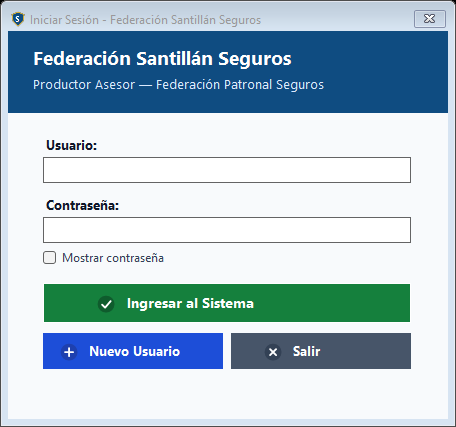
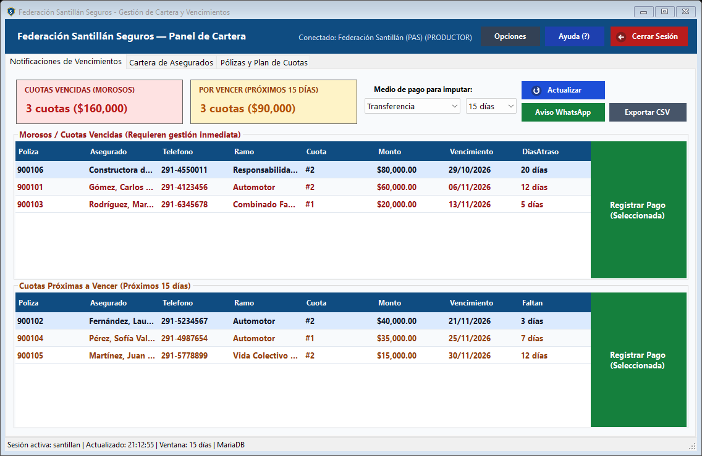
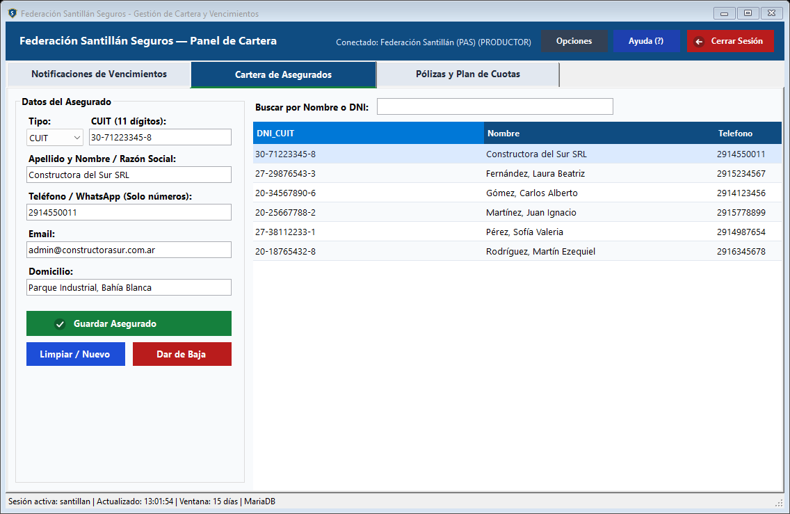
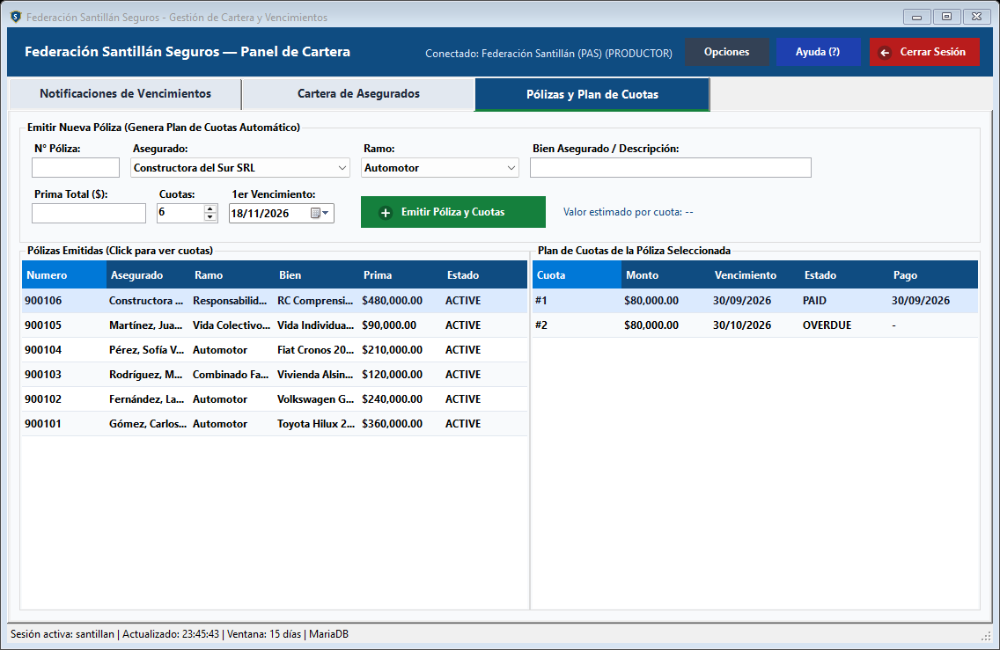
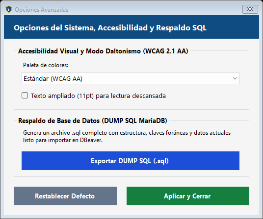

# 3. MANUAL DE USUARIO Y GUÍA DE DESPLIEGUE (DOCKER + NOVNC + MARIADB + DBEAVER)

## Parte A: Despliegue en Docker para macOS, Linux y Windows

### 1. Despliegue Completo en Contenedor Visual (Recomendado para Mac / Linux)
Esta modalidad levanta la aplicación **Windows Forms en .NET 8** sobre un subsistema Wine con interfaz gráfica web **noVNC (puerto 8080)** y el motor **MariaDB 11.4 (puerto 3306)** completamente orquestados en Docker. Permite ejecutar el sistema en Mac (Apple Silicon M1/M2/M3/M4 o Intel) sin requerir máquinas virtuales Windows (Parallels/UTM) ni software adicional.

En una terminal en la raíz del repositorio:
```bash
docker compose up --build -d
```

Esto inicia dos servicios:
* **`santillan_seguros_db`:** Motor MariaDB 11.4 con volumen persistente `mariadb_data` y scripts de inicialización (`01_schema.sql` y `02_seed.sql`).
* **`santillan_seguros_app`:** Contenedor Debian Slim multi-stage que compila la solución en .NET 8 `win-x64`, inicia `Xvfb` (framebuffer virtual), `fluxbox`, `x11vnc`, el proxy WebSocket `noVNC` en el puerto `8080` y lanza `FederacionSantillan.App.exe` vía Wine.

#### Acceso Inmediato en Mac / Navegador
Abra su navegador web favorito (Safari, Chrome o Firefox):
```text
http://localhost:8080
```
La aplicación se conectará automáticamente a la pantalla de escritorio virtual de Federación Santillán Seguros.

---

### 2. Despliegue Standalone de MariaDB y Ejecución Local (.NET SDK / Visual Studio)
Si desarrolla o ejecuta directamente en Windows con Visual Studio o .NET CLI:
```bash
# Levantar únicamente el motor de base de datos
docker compose up -d mariadb
```
Luego compilar y ejecutar:
```bash
dotnet restore FederacionSantillan.sln
dotnet test FederacionSantillan.sln
dotnet run --project src/FederacionSantillan.App/FederacionSantillan.App.csproj
```

---

### 3. Conexión de Herramientas de Gestión (DBeaver / DataGrip)
1. Abrir **DBeaver** $\rightarrow$ *Nueva Conexión* $\rightarrow$ seleccionar **MariaDB**.
2. Configurar:
   * **Host:** `localhost`
   * **Port:** `3306`
   * **Database:** `santillan_seguros`
   * **Username:** `santillan` (o `root`)
   * **Password:** `santillan123` (o `root123`)
3. Hacer clic en **Probar conexión** $\rightarrow$ **Finalizar**.
4. *(Importación manual en la máquina del docente)*: Si el docente desea importar la base en su propio MariaDB/MySQL sin Docker, simplemente ejecutar el archivo único consolidado [database/santillan_seguros_completo.sql](file:///C:/Users/arijd/Desktop/programacion/santillan-seguros/database/santillan_seguros_completo.sql) desde el Editor SQL de DBeaver.

---

## Parte B: Manual de Usuario del Sistema

### 1. Inicio de Sesión (`FormLogin`)

* Ingrese con las credenciales precargadas:
  * **Productor:** usuario `santillan` / contraseña `seguros2026`
  * **Administrador:** usuario `admin` / contraseña `admin123`
* La contraseña se muestra enmascarada con `*` (puede alternarse con la casilla *Mostrar contraseña*).
* Use la tecla `TAB` para navegar entre los campos y `ENTER` para ingresar.
* Prevención de enumeración de usuarios: Si el usuario no existe o la contraseña es errónea, el sistema responde invariablemente *"Credenciales inválidas"*.

### 2. Alta de Nuevo Usuario (`FormRegistroUsuario`)

* Desde el login, presione **Nuevo Usuario**.
* Complete Nombre y Apellido (sin números permitidos para personas físicas), Nombre de Usuario (alfanumérico puro sin espacios), Contraseña, Confirmación y Rol (`PRODUCTOR`, `OPERADOR`, `ADMIN`).

### 3. Panel Principal — Notificaciones y Vencimientos (`FormPrincipal`)

* **Pestaña 1 (Notificaciones y Cobranzas):**
  * Muestra automáticamente los KPIs de **Cuotas Vencidas** (Morosos) y **Cuotas Por Vencer (15 días)** optimizados mediante índices B-Tree en $O(\log M + K)$ e indexados en memoria en tabla hash $O(1)$.
  * Seleccione una fila, elija el medio de pago (*Transferencia*, *Efectivo*, *Débito Automático*, *MercadoPago*) y presione **Registrar Pago**.
  * Use **Aviso WhatsApp** para copiar el recordatorio personalizado al portapapeles y registrarlo en `notifications`, o **Exportar CSV** para descargar la planilla de morosos.
* **Pestaña 2 (Cartera de Asegurados):**
  
  * Alta, edición, baja lógica y búsqueda instantánea por Nombre o DNI/CUIT (ingreso 100% numérico puro con validación oficial de AFIP Módulo 11 para CUIT y 7-8 dígitos para DNI).
* **Pestaña 3 (Pólizas y Plan de Cuotas):**
  
  * Emita nuevas pólizas eligiendo Asegurado, Ramo oficial de Federación Patronal, Bien Asegurado, Prima Total, Cantidad de Cuotas y 1er Vencimiento.
  * El sistema genera automáticamente todas las cuotas mensuales en MariaDB dentro de una transacción atómica ACID (`COMMIT` / `ROLLBACK`).
* **Opciones, Accesibilidad y Respaldo SQL DUMP (`FormVerificarPassword` y `FormOpciones`):**
  
  
  * Protegido por verificación de contraseña del usuario activo, permite activar la paleta daltónica **Okabe-Ito / Alto Contraste (WCAG 2.1 AA)**, ampliar la tipografía y exportar un respaldo completo **DUMP SQL (`.sql`)** de MariaDB.
* **Centro de Ayuda (`FormAyuda`):**
  
  * Accesible desde el botón superior `Ayuda (?)`, detalla funcionalidades, atajos de teclado (`TAB`, `ENTER`, `ESC`), garantías de rendimiento y arquitectura MVC en 3 capas.
