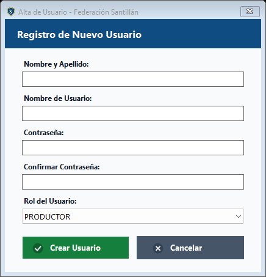
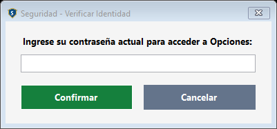
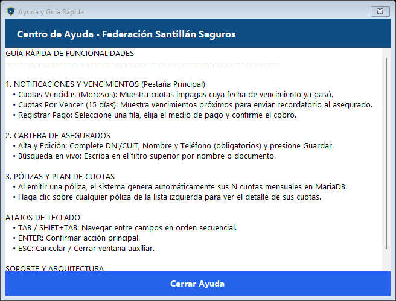

# 3. MANUAL DE USUARIO Y GUÍA DE DESPLIEGUE (DOCKER + MARIADB + DBEAVER)

## Parte A: Despliegue de Base de Datos con Docker en Mac y DBeaver

### 1. Levantar MariaDB en Mac con Docker
En una terminal en la raíz del repositorio:
```bash
docker compose up -d
```
Esto levanta automáticamente:
* Contenedor **`santillan_seguros_db`** (`mariadb:11.4`) en el puerto **`3306`**.
* Base de datos **`santillan_seguros`** con todas las tablas (`01_schema.sql`) y datos de prueba (`02_seed.sql`) ya cargados.

### 2. Conectar DBeaver
1. Abrir **DBeaver** $\rightarrow$ *Nueva Conexión* $\rightarrow$ seleccionar **MariaDB**.
2. Configurar:
   * **Host:** `localhost`
   * **Port:** `3306`
   * **Database:** `santillan_seguros`
   * **Username:** `santillan` (o `root`)
   * **Password:** `santillan123` (o `root123`)
3. Hacer clic en **Probar conexión** $\rightarrow$ **Finalizar**.
4. *(Importación manual en la máquina del docente)*: Si el docente desea importar la base en su propio MariaDB/MySQL sin Docker, simplemente ejecutar el archivo único `database/santillan_seguros_completo.sql` desde el Editor SQL de DBeaver.

### 3. Conectar desde la Máquina Virtual Windows (Parallels / UTM / VMware)
Si la app WinForms corre dentro de la VM Windows y Docker corre en macOS:
* En `src/FederacionSantillan.App/appsettings.json`, cambiar `Server=localhost` por la IP del host Mac (ej. `10.211.55.2` en Parallels o la IP local de tu red Wi-Fi, ej. `192.168.1.X`), o hacer port-forwarding hacia la VM.

---

## Parte B: Manual de Usuario del Sistema

### 1. Inicio de Sesión (`FormLogin`)

* Ingrese con las credenciales precargadas:
  * **Productor:** usuario `santillan` / contraseña `seguros2026`
  * **Administrador:** usuario `admin` / contraseña `admin123`
* La contraseña se muestra enmascarada con `*` (puede alternarse con la casilla *Mostrar contraseña*).
* Use la tecla `TAB` para navegar entre los campos y `ENTER` para ingresar.

### 2. Alta de Nuevo Usuario (`FormRegistroUsuario`)

* Desde el login, presione **Nuevo Usuario**.
* Complete Nombre y Apellido, Nombre de Usuario, Contraseña, Confirmación y Rol (`PRODUCTOR`, `OPERADOR`, `ADMIN`).

### 3. Panel Principal — Notificaciones y Vencimientos (`FormPrincipal`)

* **Pestaña 1 (Notificaciones):**
  * Muestra automáticamente los KPIs de **Cuotas Vencidas** (Morosos) y **Cuotas Por Vencer (15 días)**.
  * Seleccione una fila, elija el medio de pago (*Transferencia*, *Efectivo*, *Débito Automático*, *MercadoPago*) y presione **Registrar Pago**.
  * Use **Aviso WhatsApp** para copiar el recordatorio personalizado al portapapeles y registrarlo en `notifications`, o **Exportar CSV** para descargar la planilla de morosos.
* **Pestaña 2 (Cartera de Asegurados):**
  
  * Alta, edición, baja lógica y búsqueda instantánea por Nombre o DNI/CUIT.
* **Pestaña 3 (Pólizas y Plan de Cuotas):**
  
  * Emita nuevas pólizas eligiendo Asegurado, Ramo, Bien Asegurado, Prima Total, Cantidad de Cuotas y 1er Vencimiento.
  * El sistema genera automáticamente todas las cuotas mensuales en MariaDB dentro de una transacción atómica.
* **Opciones, Accesibilidad y Respaldo SQL DUMP (`FormVerificarPassword` y `FormOpciones`):**
  
  
  * Protegido por verificación de contraseña del usuario activo, permite activar la paleta daltónica **Okabe-Ito / Alto Contraste (WCAG 2.1 AA)**, ampliar la tipografía y exportar un respaldo completo **DUMP SQL (`.sql`)** de MariaDB.
* **Centro de Ayuda (`FormAyuda`):**
  
  * Accesible desde el botón superior `Ayuda (?)`, detalla funcionalidades, atajos de teclado (`TAB`, `ENTER`, `ESC`) y arquitectura.
